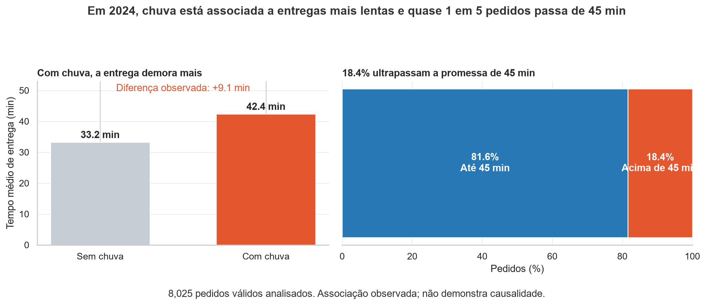

Chuva está associada a entregas mais lentas e avaliações menores: diagnóstico operacional do app de delivery em 2024

Em 2024, dias chuvosos estiveram associados a entregas cerca de 9 minutos mais demoradas e a quase 20% dos pedidos ultrapassando 45 minutos. A recomendação é reforçar a capacidade operacional e monitorar SLAs em períodos de chuva e pico de demanda.




Painel com indicadores operacionais de 2024, comparando tempo médio de entrega em dias com e sem chuva e a proporção de pedidos acima de 45 minutos. Base de 8.058 pedidos.

---

## 1. Pergunta de negócio

A diretoria do aplicativo de delivery solicitou uma análise exploratória dos pedidos realizados em 2024 para apoiar decisões operacionais e comerciais para 2025. O objetivo foi entender os fatores associados ao desempenho das entregas, ao comportamento dos clientes e ao impacto de mecanismos promocionais.

**Perguntas que guiaram a análise:**
1. [Pergunta 1 — Em quais horários e dias da semana ocorre a maior concentração de pedidos?]
2. [Pergunta 2 - A chuva está associada a tempos maiores de entrega?]
3. [Pergunta 3 - O uso de cupons está relacionado ao comportamento de novos clientes?]
4. [Pergunta 4 - Tempos maiores de entrega estão associados a avaliações menores?]
5. [Pergunta 5 - Existem diferenças relevantes entre cidades, tipos de cozinha e formas de pagamento?]

## 2. Dados

- **Fonte:** `delivery_pedidos.csv`, fornecida no módulo DS-PY-018 (dados simulados de um app de delivery). 
- **Período e escopo:** 01/01/2024 a 31/12/2024; São Paulo, Rio de Janeiro e Belo Horizonte.
- **Tamanho:** [linhas 8.058 × colunas da base original 18] → [linhas 8.058 × colunas da base limpa × 26 (remoção das colunas pais e moeda tornando 16 colunas, mas foi acrescentado 10 novas colunas: data, mes, avaliacao_ausente, faixa_tempo_entrega, tempo_invalido, distancia_invalida,mediana_cozinha, razao_valor_cozinha, pedido_grande, razao)].
- **Unidade de observação:** [pedido]

### Dicionário da base limpa (`saidas/delivery_pedidos_limpo.csv`)
        coluna	             tipo	          faltantes (%)	    exemplo
0	    pedido_id	         int64	          0.00	            500000
1	    data_hora	         datetime64[ns]	  0.00	            2024-01-01T11:21:00
2	    cidade	             object	          0.00	            São Paulo
3	    bairro	             object	          0.00	            Tatuapé
4	    restaurante_id	     object	          0.00	            R912
5	    tipo_cozinha	     object	          0.00	            Hambúrguer
6	    plataforma	         object	          0.00	            Android
7	    forma_pagamento	     object	          0.00	            Pix
8	    cupom	             bool	          0.00	            False
9	    cliente_novo	     bool	          0.00	            False
10	    chuva	             bool	          0.00	            False
11	    distancia_km	     float64          4.00	            2.68
12	    tempo_entrega_min    float64	      0.41	            28.0
13	    valor_pedido	     float64          8.94	            45540.0
14	    taxa_entrega	     float64	      0.00	            7.4
15	    avaliacao	         float64	      16.65	            4.0
16	    data	             object	          0.00	            2024-01-01
17	    mes	                 int32	          0.00	            1
18	    avaliacao_ausente    bool	          0.00	            False
19	    faixa_tempo_entrega	 category	      0.10	            Até 30 min
20	    tempo_invalido	     bool	          0.00	            False
21	    distancia_invalida	 bool	          0.00	            False
22	    mediana_cozinha	     float64	      0.00	            58580.0
23	    razao_valor_cozinha	 float64	      8.94	            0.7773984294981222
24	    pedido_grande	     bool	          0.00	            False
25	    razao	             float64	      8.94	            0.7773984294981222

[Gere esta tabela pelo notebook (Tarefa 11.1) e complete a descrição. Inclua as colunas e as **flags** que vocês criaram.]

| Coluna | Tipo | Descrição | % faltantes | Observação / tratamento |
|---|---|---|---|---|
| `pedido_id` | int | identificador do pedido | 0 | — |
| `data_hora` | datetime | data e hora do pedido | 0 | convertida de texto |
| `cidade` | texto | cidade de entrega | 0 | [ex.: 13 variantes padronizadas para 3 nomes] |
| `valor_pedido` | float | valor dos itens em R$, sem taxa | 0 | [ex.: 720 valores no formato "R$ 44,02" convertidos] |
| `tempo_entrega_min` | float | minutos do pedido à entrega | [ ] | [ex.: 25 códigos 999 e 8 negativos → NaN] |
| `...` | | | | |
| `tempo_invalido` | bool | **flag** criada | 0 | [o que significa True] |
| `pedido_grande` | bool | **flag** criada | 0 | [critério usado] |

## 3. Como rodar

```bash
git clone [URL do repositório]
cd [pasta]
python -m venv .venv && source .venv/bin/activate     # Windows: .venv\Scripts\activate
pip install -r requirements.txt
jupyter notebook projeto_final.ipynb
```

- O notebook lê o CSV original em `[caminho relativo, ex.: dados/delivery_pedidos.csv]`. [Explique onde colocar o arquivo, se ele não estiver no repositório.]
- Execute **Kernel → Restart & Run All**. Tempo aproximado: [ ] segundos.
- Versões usadas: Python [X], pandas [X], seaborn [X], matplotlib [X], scipy [X] (ver `requirements.txt`).

## 4. Estrutura do repositório

```
.
├── README.md                     ← este arquivo
├── requirements.txt
├── projeto_final.ipynb           ← análise completa (Etapas 1 a 11)
├── autoavaliacao.md              ← ficha de autoavaliação preenchida
├── dados/
│   └── delivery_pedidos.csv      ← base original (NÃO editada)
└── saidas/
    ├── delivery_pedidos_limpo.csv
    └── figura_principal.png

```

## 5. Metodologia

1. **Perguntas e hipóteses** — [definição de seis hipóteses relacionadas a operação, chuva, cupons e comportamento dos clientes. ]
2. **Carga e inspeção** — [3 colunas com identificação de valores faltantes, 1 coluna com tipo inadequado e 2 colunas inconsistências de grafia, 2 colunas constantes.]
3. **Limpeza** — [2 colunas padronização de cidades com 13 grafias diferentes e formas de pagamento com 8 grafias diferentes, 3 colunas tratamento de faltantes com 186 linhas afetadas, 2 colunas constantes removidas, 2 colunas conversões de tipos.]
4. **Outliers** — [manutenção dos pedidos extremos após análise, utilizando flag específica para investigação.]
5. **Estatística descritiva** — [cálculo de KPIs operacionais, financeiros e de experiência do cliente.]
6. **Sumarização e granularidade** — [análises por pedido - O volume de pedidos cresceu ao longo de 2024., cidade - as cidades têm indicadores semelhantes de ticket, entrega, avaliação e uso de cupons; a principal diferença está no volume de pedidos e faturamento, maiores em São Paulo.,  - A cozinha Japonesa tem o maior ticket médio e também o maior ticket mediano, a ordem por volume não é igual à ordem por faturamento., Três granularidades de tempo mês, semana e dia - Cada granularidade responde a uma pergunta diferente: a diária revela eventos pontuais, a semanal facilita comparações de curto prazo e a mensal mostra a tendência geral do ano.]
7. **Visualização** — [gráficos temporais, distribuições, heatmaps, boxplots e painéis comparativos.]
8. **Correlação** — [gráficos temporais, distribuições, heatmaps, boxplots e painéis comparativos.]
9. **Testes de hipótese** — [Welch, Mann-Whitney, Kruskal-Wallis, Qui-quadrado, regressão logística e permutação com α=5%.]
10. **Conclusões** — [consolidação de evidências para recomendações operacionais e comerciais.]

### Decisões de limpeza


Problema	                 |Linhas afetadas | Decisão	                     |Alternativa considerada
tempo_entrega_min = 999	     |   25	          | Converter para ausente + flag|	Remover registros
tempo_entrega_min negativo	 |   8	          | Converter para ausente + flag|	Remover registros
plataforma ausente	         |   153	      | Preencher como "Desconhecida"|	Exclusão das linhas
cidade com 13 grafias	     |   Diversas	  | Padronização	             |  Manter original
forma_pagamento com 8 grafias|	 Diversas	  | Padronização	             |  Manter original


## 6. Principais achados

1. **[Achado 1 em negrito].** [**18,39% dos pedidos válidos de 2024 (1.476 de 8.025) ultrapassaram 45 minutos.** Fonte: Tarefa 5.4. Isso representa quase um pedido em cada cinco acima do prazo prometido.]
2. **[Achado 2].** [**Nos cidade-dias chuvosos, o tempo médio de entrega foi 9,03 minutos maior.** Fonte: Tarefas 6.8 e 9.1; teste t de Welch, *p* < 0,001. O resultado sugere uma associação relevante para o planejamento operacional, mas não prova causalidade. ]
3. **[Achado 3].** [**A média diária passou de 20,04 pedidos no primeiro trimestre para 24,09 no quarto, aumento aproximado de 20,2%.** Fonte: Tarefa 6.9. A tendência linear estimou crescimento de 31,07%, excluindo o dia anômalo 14/08; isso aponta para a necessidade de acompanhar e planejar a capacidade conforme a demanda. ]
4. **[Achado 4].** [**Em julho, 45,62% dos pedidos usaram cupom e houve 26,52 pedidos por dia, em média.** Fonte: Tarefa 6.7. O pico de uso de cupons coincidiu com maior volume, mas os dados não demonstram que os cupons tenham causado esse aumento. ]
5. **[Achado 5].** [**A mediana do ticket variou R$ 66.700 entre Japonesa (R$ 103.240) e Doces (R$ 36.540).** Fonte: Tarefas 6.3 e 9.4; Kruskal–Wallis, *p* < 0,001, ε² = 0,266. Essa diferença pode orientar investigações sobre o mix comercial; o teste não identifica sozinho quais pares de cozinhas diferem. ]

### Hipóteses testadas (α = 5%)

Hipótese                       | Teste	                    |p-valor	 |Efeito	              |Decisão	      |Linguagem de negócio

H1 chuva × tempo de entrega	   | t bilateral de Welch       |3,54×10⁻¹²¹ |+9,03 min	              |Rejeita H0	  |Chuva está associada a entregas mais lentas

H2 cupom × ticket	           | Permutação	                |0,00019998  |Mediana menor com cupom |Rejeita H0	  |Clientes com cupom apresentam ticket diferente

H3 tempo × avaliação	       | Mann-Whitney / Spearman    |<0,001	     |-1 ponto na mediana	  |Rejeita H0	  |Atrasos estão associados a avaliações piores

H4 cozinha × ticket	           | Kruskal-Wallis / ANOVA     |<0,001	     |ε²=0,266	              |Rejeita H0	  |Cozinhas possuem tickets distintos

H5 cidade × forma de pagamento | Qui-quadrado	            |0,695	     |V=0,015	              |Não rejeita H0 |Forma de pagamento é semelhante entre cidades

H6 cupom × cliente novo	       | Regressão logística / Wald |3.07X10-89    |OR=3,647	          |Rejeita H0	  |Pedidos com cupom estão associados a maior chance de serem de clientes novos

## 7. Recomendações

| # | Recomendação | Achados que sustentam | Métrica para acompanhar |
|---|---|---|---|
| 1 | [Reduzir atrasos na entrega: planejar capacidade adicional nos períodos de maior demanda e avaliar medidas operacionais para dias chuvosos, quando o tempo médio foi 9,03 minutos maior. ] | [achados das tarefas 5.4 e 6.8. ] | [percentual de pedidos acima de 45 minutos, acompanhado separadamente em dias chuvosos e secos. ] |

| 2 | [Avaliar a campanha de cupons de julho: comparar campanhas futuras com períodos sem promoção e verificar se o aumento de pedidos compensa o custo do desconto, sem presumir que o cupom causou o pico de julho. ] | [achado da tarefa 6.7; julho teve 45,62% de uso de cupom e média de 26,52 pedidos por dia. ] | [pedidos por dia, taxa de uso do cupom e faturamento ou margem por pedido durante a campanha e em um período de comparação. ] |

| 3 | [ Ajustar o mix comercial por tipo de cozinha: investigar o maior ticket mediano da culinária Japonesa e o menor de Doces para orientar ofertas, preços e divulgação, validando a rentabilidade antes de expandir qualquer estratégia.] | [achados das tarefas 6.3 e 9.4. ] | [ticket mediano, faturamento e margem por tipo de cozinha. ] |

## 8. Limitações

- [Não é possível concluir causalidade. Os dados mostram que entregas em dias chuvosos demoraram, em média, 9,03 minutos a mais, e que o uso de cupom está associado a mais clientes novos. Como a análise é observacional, não prova que chuva cause atrasos nem que cupons atraiam clientes; distância, horário, cidade e campanhas simultâneas podem influenciar essas relações. ]
- [Possíveis confundidores não controlados: trânsito, distância, horário de pico, região, disponibilidade de entregadores e campanhas simultâneas podem influenciar os resultados. ]
- [Alguns resultados são associações gerais, não diferenças entre todos os grupos. O teste de Kruskal–Wallis encontrou diferenças nos tickets entre tipos de cozinha, mas não identifica quais pares diferem sem análises pós-hoc. O resultado não prova que a cozinha, por si só, explique a diferença. ]
- [Testes estatísticos têm pressupostos e limites: valores extremos, observações relacionadas e diferenças de tamanho entre grupos podem afetar os resultados. Um resultado significativo não garante relevância prática; a análise de cozinha, por exemplo, indica que existe diferença entre grupos, mas não identifica por si só quais pares diferem.]

## 9. Próximos passos

- [Realizar análises de retenção de clientes após uso de cupons. ]
- [Investigar causas dos pedidos acima de 45 minutos. ]

## 10. Autores

| Nome     | GitHub          | Principais contribuições                                              |
|---       |---              |---                                                                    |
| [FABIO ] | [fabiodepf-dot] | [Carga e inspeção (Etapas 1–2), README, e base: delivery_pedidos.csv] |
| [FABIO ] | [fabiodepf-dot] | [Conclusão do trabalho Projeto_final.ipynb, README. ]                 |


*Projeto final do módulo DS-PY-018 · Análise Exploratória de Dados · [CAIXA VERSO — Turma 1735, novembro/2026]*

---

<!--
CHECKLIST ANTES DE PUBLICAR (apague este bloco no README final)
[X] Todos os [colchetes] foram substituídos
[X] A figura principal aparece no topo (caminho relativo correto)
[X] Os números do README batem com o notebook executado
[ ] "Como rodar" foi testado num clone limpo do repositório
[ ] requirements.txt existe e tem versões
[X] Histórico de commits com mensagens descritivas
-->
